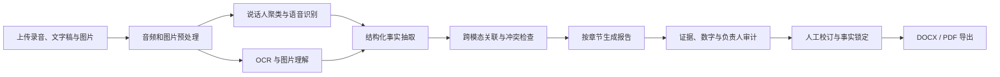

# K3 会议智记：产品与技术介绍

## 一句话定位

K3 会议智记是一套运行在进迭时空 K3 开发板上的会后会议材料生产工具。它把会议录音、现场拍摄的 PPT、已有文字稿和人工修订组织成一份结构清晰、证据可回溯、可继续编辑的正式会议报告，而不只是生成一段不可核验的摘要。

系统面向单用户、会后异步处理场景，支持完全本地运行，也支持只把低置信度片段送往云端复核。首版重点解决中文会议、中英文技术术语混杂、现场 PPT 拍摄质量不稳定，以及小模型上下文有限等问题。

---

## 为什么要做这套工具

常见的会议 AI 产品通常以“录音转文字 + 全文摘要”为终点，但一份真正可交付的会议材料还需要回答更多问题：

- 哪些是已经达成的决定，哪些只是讨论意见？
- 行动项由谁负责，何时完成，原话在哪里？
- 报告中的数字、日期和产品名称能否找到证据？
- PPT 上的图表与演讲内容如何对应？
- 模型不确定或不同来源发生冲突时，是否会明确提示？
- 用户修订后的姓名和事实，重新生成报告时会不会被模型覆盖？

K3 会议智记将目标从“生成摘要”提升为“生产可信、可读、可审计的会议文档”。系统宁可把内容放入“待核实项”，也不把缺少证据的推测写成正式结论。

---

## 产品定位

### 适合的场景

- 技术分享、方案评审、项目复盘和内部培训；
- 2–8 人、以中文为主并夹杂英文术语的会议；
- 会议结束后上传录音、文字稿和 PPT 照片；
- 涉及隐私或内部技术信息，需要优先本地处理；
- 最终需要 Word/PDF，而非只在网页中查看一段摘要。

### 当前不解决的问题

- 实时字幕与会议中实时问答；
- 多租户和复杂组织权限；
- 无人值守直接发布所有会议报告；
- 用生成式修复猜测模糊图片中的文字；
- 用 Swap 掩盖模型超过 K3 物理内存的问题。

### 三种报告深度

| 类型 | 适用场景 | 主要内容 |
|---|---|---|
| 精简纪要 | 快速了解会议结果 | 摘要、决定、行动项、风险 |
| 标准报告 | 日常项目会议 | 议题过程、决定、行动项、未决问题、证据 |
| 技术整理文稿 | 技术开放日、分享会、培训 | 按主题展开的解释性正文、技术要点、比较表格、图片说明和完整来源索引 |

“技术整理文稿”不是把摘要写得更长。系统会先建立全场材料目录，再逐章检索相关事实和图片，分别生成章节，最后做跨章节一致性检查。

---

## 核心方法

### 1. 先保存证据，再生成结论

系统将材料分成三个层次：

1. **原始材料**：录音、原始转写、PPT 原图、OCR 坐标和模型原始输出；
2. **结构化事实**：议题、决定、行动项、风险、问题、指标和术语；
3. **人类文档**：摘要、技术正文、表格、图片说明、附录和来源索引。

原始识别结果不会被自动校正或用户修改覆盖。用户看到的是修订后的视图，但系统始终保留原始版本和修改来源。

每条决定、行动项、数字和日期都必须引用至少一项证据，例如：

```text
决定：下一阶段优先验证硬件辅助验证流程。
证据：音频 00:42:13–00:42:51；PPT 来源 S17 的标题与流程图区域。
```

找不到证据的内容不会进入正式结论，而是进入“待核实项”。

### 2. 用事实库解决小模型的上下文限制

K3 的 8GB 内存无法长期同时运行多个大模型，也不适合把整场会议一次性塞入上下文。系统因此不使用反复压缩的滚动摘要，而采用结构化事实库：

```text
会议材料
  → 按说话轮次和议题切分窗口
  → 每个窗口只抽取结构化事实
  → 合并重复事实并记录冲突
  → 按报告章节检索相关事实
  → 逐章生成并执行证据审计
```

这种方法有三个直接收益：

- 早期遗漏不会在多轮摘要中被永久放大；
- 修改一条事实后只需重生成相关章节；
- 每个结论都能保留独立证据，不依赖模型“记得全文”。

### 3. OCR 与多模态模型分工协作

PPT 图片需要同时解决“写了什么”和“表达什么”两个问题：

- OCR 负责逐字文本、数字、坐标和置信度；
- 多模态模型负责页面主题、流程关系、图表含义和演讲上下文；
- 关联模块使用时间、上传顺序、关键词、实体和议题匹配图片与转写；
- 低置信度关系交给用户确认。

OCR 结果适合作为可定位的文字证据，多模态模型的解释则作为候选理解。对于模糊、遮挡或透视严重的区域，系统会明确标记不可辨识，不允许模型推测补全。

### 4. 串行模型调度适配 K3

系统一次只运行一个重型推理阶段。模型管理器负责加载、健康检查、终止旧模型并确认内存释放，使有限内存优先用于当前任务：

```text
音频处理 → ASR → 图片处理 → 事实抽取 → 报告生成
              每个重型阶段完成后卸载模型
```

本地文本与多模态推理使用 K3 定制 `llama.cpp`，可启用 A100 AI 核、IME2 矩阵扩展和 TCM。ONNX 模型用于 VAD、说话人表征、OCR 等专用任务。产品运行要求保留安全内存，不依赖 Swap 维持表面可用。

### 5. 人工修订是受保护的数据，而不是临时提示词

用户可以：

- 把 `Speaker 1` 批量改为真实姓名；
- 修订转写但保留原始识别；
- 修改并锁定事实；
- 确认或取消图片关联；
- 只重生成指定章节；
- 在报告编辑器中继续调整文字。

用户锁定的事实不会被后续模型生成覆盖。这使系统适合“模型生成候选、用户负责最终发布”的真实工作流程。

---

## 处理流程



任务被拆分成可恢复阶段。服务重启或某个模型进程失败后，可以从检查点继续处理，而不必重新执行整场会议。

---

## 用户最终得到什么

系统的交付物不是后台 JSON，而是一份面向读者组织的正式文档。详细报告可包含：

1. 会议背景与阅读导引；
2. 执行摘要；
3. 按主题组织的技术内容；
4. 关键决定与依据；
5. 行动项、负责人和截止时间；
6. 风险与未决问题；
7. 与正文相邻的重点 PPT；
8. 完整图片索引；
9. 正式事实与证据脚注；
10. 可回溯的来源索引。

正文只展示简洁的 `S01`、`S02` 等来源编号，内部数据库 ID 不会泄露到交付文档。读者可以从正文跳转到音频时间段或对应 PPT，而不必阅读低质量 OCR 原文。

---

## K3 真机效果

以下结果来自 8GB K3 Pico-ITX 和项目现有真实素材，不是桌面 GPU 上的模拟数据。

### 音频与说话人处理

- 91 分 08 秒飞书中文会议稿解析为 117 个说话轮次、8 位说话人和 19 个事实窗口；
- 52 分 24.6 秒中英混合音频得到 49 个语音区间、146 个 ASR 切片；
- Qwen3-ASR-0.6B 完成约 2945.6 秒有效语音转写，耗时 431.5 秒，RTF 为 0.143；
- 146 个切片中 144 个获得文本，其余 2 个为低概率短 VAD 误触发；
- CAM++ 完成 1988 个全局声纹窗口聚类，峰值内存约 268MiB。

更大的模型并不必然更适合板端。Qwen3-ASR-1.7B 在真实中英混合片段上出现空文本和重复解码；VibeVoice 对部分英文术语更准确，但真实片段 RTF 为 6.53–10.82，且峰值内存约 5.16GiB。因此当前主链保留 0.6B，VibeVoice 只适合作为少量疑难片段的候选复核。

### 图片理解

- 31 张会场 PPT 原图和确定性增强图均被保存并建立证据记录；
- PP-OCR 原图关键行召回率为 36.84%，说明现场照片不能只依赖 OCR；
- FastVLM 严格 JSON 成功率为 35%；
- Qwen3.5-2B 配合 OCR、重试和确定性门禁后达到 95% 严格 JSON 成功率；
- Qwen3.5-4B 的峰值内存超过产品规定的 6.2GiB，因此没有以“未发生 OOM”为理由进入部署方案。

这些结果促使系统采用“OCR 提供文字证据、VLM 提供语义候选、确定性规则负责准入”的组合，而不是让一个模型包办图片处理。

### 事实与报告

- Qwen3-0.6B 的真实事实样本只有 2/4 完整通过；
- Qwen3-4B 在同一批真实样本上达到 4/4，严格结构连续 20 次合法；
- 最终正式技术文稿包含 10 章、32 个小节和 22,243 个字符；
- 正文引用覆盖 31/31 张原图；
- 确定性审计覆盖 144 条非降级转写、175 条证据、9 个报告章节和 9 条正式事实；
- 正式事实证据覆盖率为 100%；
- 板端最终导出 26 页 A4 DOCX/PDF，包含 6 张重点原图和 31 张完整缩略图索引；
- PDF 逐页检查未发现中文缺字、裁切、重叠、孤立标题或图片与说明分离，字体均已嵌入。

上述为历史内部验证记录。原始会议材料、报告和截图不随公开源码发布；公开演示样例需另行完成授权及脱敏。

---

## 当前达到的产品边界

目前已经达到可演示、可校订、可导出的人机协作产品形态，但尚不能宣称“任意会议都可以全自动生成可直接发布的报告”。

已经验证：

- K3 上的完整阶段化处理和模型串行装卸；
- 原始材料、事实与报告分层保存；
- 用户修订、事实锁定和章节重生成；
- 音频、图片和正式事实的证据回溯；
- 中文 DOCX/PDF 的稳定导出；
- 模型崩溃和服务重启后的阶段恢复；
- 在真实素材上生成结构完整、适合人类阅读的详细技术文稿。

仍未通过正式验收：

- 缺少 10 场带人工真值的会议，不能诚实给出总体 CER、DER 和事实召回率；
- 当前没有可直接部署的 K3 强制对齐模型；
- 52 分钟富材料会议的高质量本地处理约 64 分钟，尚未达到 40 分钟目标；
- 本地 4B 模型无人值守生成的详细正文仍存在术语误译、句子截断和图片含义误判。

因此，当前可交付路径是：

> 模型完成识别、事实候选和初稿生成，系统执行确定性证据与排版门禁，用户完成关键语义校订并锁定结果，最终导出正式文档。

这条边界不是降低标准，而是确保对外提供的材料真正可读、可信，并能够说明每项结论来自哪里。

---

## 本地与端云协同

系统提供两种运行模式：

- **LOCAL_ONLY**：所有材料在 K3 本地处理，适合敏感会议；
- **HYBRID_REVIEW**：先完成本地处理，只发送识别失败、图片冲突或结构化输出不稳定的局部材料。

混合模式不会默认上传整场会议。外发内容、调用模型和时间会被记录，云端返回只作为候选版本保存，不直接覆盖本地结果或用户修订。

---

## 项目价值

K3 会议智记验证了一条不同于“堆大模型和长上下文”的端侧路线：

- 用任务分解和检索编排弥补小模型上下文限制；
- 用结构化事实与证据约束降低幻觉风险；
- 用专用模型组合替代单一模型包办所有任务；
- 用串行装卸让 8GB 设备完成多阶段会议处理；
- 用人工锁定和发布门禁保证最终材料质量；
- 用真实失败数据决定模型选型，而不是只比较参数规模。

它的核心成果并非“在开发板上跑起来一个大模型”，而是在有限算力上建立了一套面向正式文档交付的、可恢复、可审计、可持续改进的会议处理方法。

---

## 延伸阅读

开发、部署、模型配置、基准测试和详细验收记录请参阅项目根目录的 [README](../README.md)。
